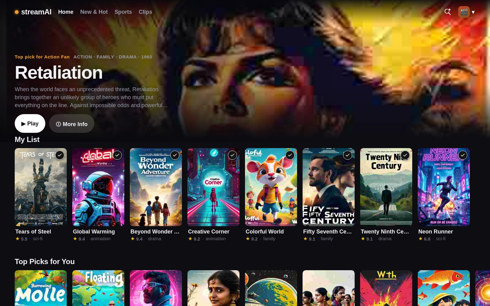
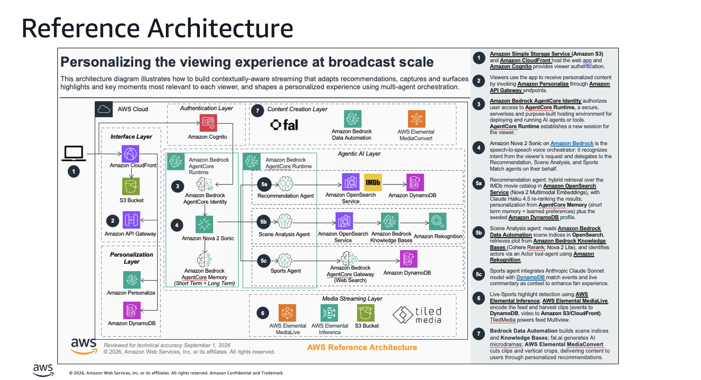
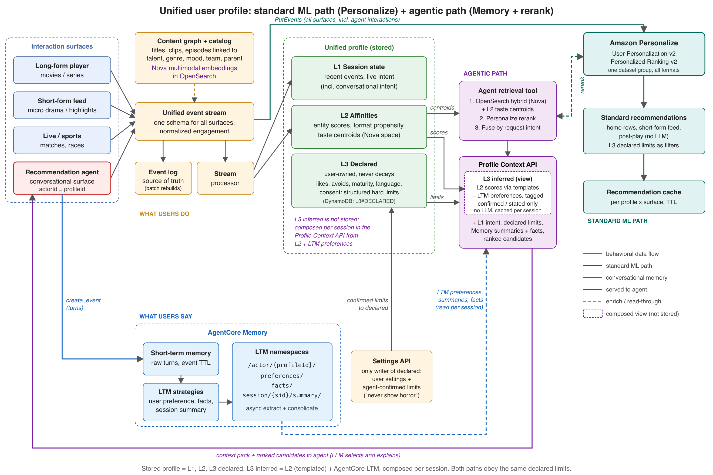

# Hyper-Personalized Movie Assistant

> **Looking for version 1?** This `main` branch now holds version 2 of the solution. The version 1 code, which the original blog post refers to, is on the [`v1` branch](https://github.com/aws-samples/sample-hyper-personalized-agentic-ai-media-assistant/tree/v1) (also tagged [`v1.0.0`](https://github.com/aws-samples/sample-hyper-personalized-agentic-ai-media-assistant/releases/tag/v1.0.0)). To get it: `git clone -b v1 https://github.com/aws-samples/sample-hyper-personalized-agentic-ai-media-assistant.git`

A streaming demo that personalizes search, home rows, clips and live sports from one unified viewer profile. The assistants run on [Amazon Bedrock AgentCore](https://docs.aws.amazon.com/bedrock-agentcore/) Runtime and are built with [Strands Agents](https://strandsagents.com/). The whole stack deploys with CDK from one environment file (`infra/environments/<name>.json`, copied from `example.json`). All demo data ships in this repository: a synthetic movie catalog with posters, AI-generated micro-dramas, and a synthetic football match with its video.



*Home for the Action Fan profile. The top pick and rows come from that profile's taste; posters are from the synthetic catalog.*

## What's new in v2

Version 1 of this sample is on the [`v1` branch](https://github.com/aws-samples/sample-hyper-personalized-agentic-ai-media-assistant/tree/v1): a speech-to-speech movie recommendation assistant with Amazon Nova Sonic and a synthetic movie catalog. Version 2 keeps that catalog and adds:

- **A unified viewer profile** shared by every surface: measured session behaviour (L1), learned taste with up to three taste centroids (L2) and declared preferences and limits (L3), fed by a viewing-event stream.
- **A new recommendation agent** on Amazon Bedrock AgentCore Runtime with Strands Agents: one structured understanding step, rule-based routing to filtered hybrid search, prompt-cached shard fan-out or taste retrieval, and a taste-aware rerank.
- **Personalized surfaces:** Home rows, search starter options, a short-form clips feed with AI-generated micro-dramas, and title-page highlights chosen by taste.
- **A spoiler-safe live sports assistant** for a synthetic football match that answers only from events before the playhead.
- **Scene analysis** of Tears of Steel with Bedrock Data Automation, adapted from v1's notebooks.
- **One CDK deployment** from a single environment file, with data loaders and end-to-end checks.

## Reference architecture



This is the reference architecture used in the IBC 2026 demo of this solution. The open-source version implements the same architecture with sample data in place of the partner content shown at the event.

## Repository layout

```
data/
  catalog/              Synthetic movie catalog (500 titles), Tears of Steel, 8 micro-dramas, posters.zip
  media/                Zipped demo videos: micro-dramas and the football match
backend/
  movie-ai-agent-v2/    Recommendation + scene-analysis agent (movie runtime)
  live-sports-agent/    Spoiler-safe match assistant (sports runtime)
  movie-voice-agent/    Nova Sonic voice concierge over WebSocket (voice runtime)
  shard-warmer/         Scheduled Lambda that keeps the shard prompt caches warm
frontend/               React + Vite web app (profiles, Home, Search, players, Clips, sports)
infra/
  deployment/           CDK stacks, deploy runner, seed data, tests, smoke checks
  environments/         Per-environment settings (copy example.json)
  lambdas/              API Lambdas (household, settings, events, clips, lists, playback)
  layers/shared/        Shared Lambda layer (profile helpers, tappable-option pool)
insights/               Read-only insights console: 3D taste map, What-if runs, live agent stream
scripts/                Offline builders and media/seed helpers
docs/                   Design docs and architecture diagrams
```

## The unified profile

Every household member has one profile in the `profiles` DynamoDB table, in three layers:

| Layer | Item | What it holds | Written by |
|---|---|---|---|
| L1 session | `SESSION#behavior` | Measured session facts: format mix, recent completes and skips, session entities, device | Events processor |
| L2 learned taste | `AFFINITIES` | Entity affinities, up to 3 taste centroids, time-of-day taste, starter `tappable_options` | Events processor |
| L3 declared | `L3#DECLARED` | Loved and never genres, avoided themes, follows, kids limit | Settings API and onboarding |

Viewing events flow from the app to `POST /events`, into a Kinesis stream, then to the `profile_events` processor Lambda. Firehose also archives the raw stream to S3. AgentCore Memory adds conversation history and long-term preferences extracted from chats.

When signals conflict, precedence is: limits, then the current request, then L3 declared preferences, then L2 learned taste.



See `docs/unified-profile-design.md` for the full design. For a plain-language explanation of what the app learns from viewing and how each screen uses it, see `docs/how-personalization-works.md`.

## Recommendation agent

`backend/movie-ai-agent-v2/agent_v2.py` runs each request through four steps and streams status events between them:

1. **Understand** (`understand.py`): one model call, with its fixed system prompt cached by Bedrock, turns the conversation into structured intent and reports which L3 rules the request overrides. A question about titles already shown ("Who directs that one?") skips the next steps and gets a text-only answer from `answer.py`.
2. **Route** (`router.py`): fixed rules read the intent fields and pick one path:
   - **Filtered hybrid search** (`catchall.py`, `retrieval.py`) for hard constraints such as a person, years, a rating or kids. Constraints filter OpenSearch Serverless, while genres and keywords only add to the hybrid kNN + BM25 score.
   - **Model-curated picks** (`fanout.py`) for mood or genre requests. The catalog is split into prompt-cached shards that a model reads in parallel.
   - **Taste retrieval** (`catch_all_taste`) for open requests like "surprise me". It runs one kNN search per taste centroid.
3. **Rerank** (`reduce.py`): orders the candidates using learned taste as soft guidance, and returns follow-up chips.
4. **Respond**: rehydrates full title records and playback URLs.

Requests with `request_type: "analysis"` go to the scene-analysis agent (`analysis_agent.py`). See `backend/movie-ai-agent-v2/README.md` for the request contract and settings.

## Personalized surfaces

- **Home** (`GET /home`): rows ranked from the profile. A newly added profile gets cold-start rows built from its loved genres and L3 limits (`infra/lambdas/household/cold_start.py`).
- **Search starter options** (`GET /home?part=options`): the processor ranks a pre-built pool (`infra/deployment/seed/tappable_options.json`, built by `scripts/build_tappable_pool.py`) against the taste centroids and stores 6 options on `AFFINITIES`. They change only when taste changes. Profiles with no taste get 3 random generic options. No model is called per viewer.
- **Clips feed** (`/clips/*`): ranks short clips from in-session interests, rebuilt from the session's impressions on each request, with the L2 taste centroids as priors.
- **Title highlight** (`GET /get_video_url?highlight=1`): the preview on Title Detail. A title can have several highlight cuts, for example a rom-com scene and an action scene. Tears of Steel has two, an action cut and a romantic cut, made by `notebooks/tears-of-steel/1-video-scenes.ipynb`. Each cut is annotated in S3 with a one-sentence genre label: `infra/deployment/annotate_highlights.py` writes the sentences from `infra/deployment/seed/highlight_descriptions.json` onto each video object as metadata (`x-amz-meta-description`), so the label lives with the clip and needs no database. `infra/lambdas/get_video_url` embeds each label with Nova Multimodal Embeddings, cached per warm container, and plays the cut whose label is closest (cosine) to the weight-averaged L2 taste centroids. A title with one cut, a profile with no taste, or cuts with no labels get the first cut.
- **Live sports**: a synthetic match, Harbor City FC vs Redcliffe Athletic, played over a 60-second clip that covers the 78th minute (`backend/live-sports-agent/build_synthetic_match.py`). The follows in L3 drive which matches are surfaced. The sports agent answers only from events before the playhead.

## Deploy

The deployment bills by the hour while it exists, mainly the OpenSearch Serverless collection (about $175 a month idle); see [Cost](infra/deployment/README.md#cost). Delete it when you are done ([Clean up](#clean-up)).

### Prerequisites

- **Tools:** Python 3.12, Node.js 22 or newer with npm, Git, the AWS CLI v2, and Docker (running) for the insights console's two Lambda images (`linux/amd64`). The agent images build in AWS CodeBuild, not locally.
- **Disk:** about 2 GB for the dependencies and build output, plus 2.5 GB if you run the Tears of Steel notebooks.
- **AWS account and Region:** an account where you can create IAM roles (administrator access is simplest), in a Region with Amazon Bedrock AgentCore, Amazon OpenSearch Serverless and the models below.
- **Credentials:** the scripts use the standard AWS credential chain: an IAM Identity Center (SSO) or named profile through `AWS_PROFILE`, environment keys, CloudShell, or an instance role. They refuse to run when the credentials are for a different account than your environment file.
- **Bedrock models:** Bedrock enables serverless models on first use, but [Anthropic models need a one-time use-case form](https://docs.aws.amazon.com/bedrock/latest/userguide/model-access.html) for the account; open any Claude model in the Bedrock console's Model catalog to submit it. The first call to a third-party model also subscribes the account through AWS Marketplace, which the deploying role must be allowed to do. The default `models` in the environment file use:

  | Model | Used for | Region |
  |---|---|---|
  | Claude Haiku 5.5 (`us.` inference profile) | Movie agent | Deployment Region |
  | Claude Haiku 4.5 | AgentCore Memory extraction | Deployment Region |
  | Claude Sonnet 4.5 | Live-sports agent | Deployment Region |
  | Amazon Nova 2 Lite | Scene analysis, web grounding | Deployment Region |
  | Amazon Nova 2 Sonic | Voice agent | Deployment Region |
  | Amazon Nova Multimodal Embeddings | Catalog search and highlight matching | `us-east-1` (`embeddingRegion`) |
  | Amazon Titan Text Embeddings V2 | Scripts Knowledge Base | Deployment Region |
  | Cohere Rerank 3.5 | Scene analysis (optional notebooks) | Deployment Region |

### Steps

1. Get the code and install the dependencies:

   ```bash
   git clone https://github.com/aws-samples/sample-hyper-personalized-agentic-ai-media-assistant.git
   cd sample-hyper-personalized-agentic-ai-media-assistant
   python3.12 -m venv .venv
   .venv/bin/python -m pip install -r infra/deployment/requirements.txt pytest
   npm --prefix frontend ci
   npm install --prefix .cdk-cli aws-cdk@2.1128.1
   export CDK_CLI=$PWD/.cdk-cli/node_modules/.bin/cdk
   ```

2. Choose the AWS credentials for the target account:

   ```bash
   export AWS_PROFILE=<your-profile>   # signed in already (e.g. aws sso login for an SSO profile)
   ```

3. Create your environment file. Copy the example and replace the two `<your-account-id>` placeholders (in `account` and `mediaBucket`) with your 12-digit account ID. Change `region` if you don't deploy to `us-west-2`, and change `prefix`, `stackPrefix` and `qualifier` if the account already has a deployment with those names.

   ```bash
   cp infra/environments/example.json infra/environments/demo.json
   CONFIG=infra/environments/demo.json
   ```

4. Deploy everything and create a sign-in user. This takes 30 to 45 minutes and runs unattended:

   ```bash
   .venv/bin/python infra/deployment/deploy.py --config $CONFIG --create-user <login>
   ```

   It deploys the stacks, loads the data shipped in this repository (posters, micro-dramas, the football match and the catalog index), deploys the insights console, and runs the smoke and end-to-end checks. At the end it prints the app URL, your login and its password. The password is shown only once. If it fails, see [Troubleshooting](#troubleshooting).

5. Open the printed `App` URL and sign in. The `Insights` URL is the insights console.

6. Optional: run the [Tears of Steel notebooks](#scene-analysis-optional-tears-of-steel) for movie playback and scene analysis.

To add another login later: `.venv/bin/python infra/deployment/deploy.py --config $CONFIG --phase user --create-user <login>`. Each user gets the sample household at first sign-in.

`deploy.py` also runs one phase at a time (`--phase bootstrap`, `build`, `application`, `frontend`, `data`, `insights`, `check`), for example `--phase build` and then `--phase application` after changing agent code. `infra/deployment/README.md` describes the phases, the environment file fields and the data loaders.

## Clean up

```bash
.venv/bin/python infra/deployment/destroy.py --config $CONFIG          # lists what would be deleted
.venv/bin/python infra/deployment/destroy.py --config $CONFIG --yes    # deletes it
```

`destroy.py` deletes the stacks (Insights, Frontend, Application, Build, Bootstrap) and everything they keep on purpose: buckets, tables, the user pool, the search collection, container repositories, log groups and the media signing key. It matches exact names from your environment file, so other deployments in the account are never touched. It keeps your content bucket `mediaBucket` unless you add `--include-media-bucket`. It takes 30 to 40 minutes, and the deletions cannot be undone. If it is interrupted, run it again; what is already gone is skipped.

## Test

```bash
HPM_CONFIG=$CONFIG .venv/bin/python -m pytest infra/deployment insights/tests -q
npm --prefix frontend run build && npm --prefix frontend run lint
.venv/bin/python infra/deployment/deploy.py --config $CONFIG --phase check
```

The pytest suite covers the agent pipeline, the profile layers, the events processor, the household and settings APIs, and the stack synthesis. `HPM_CONFIG` points the template tests at your deployment's synthesized templates; without a synthesized deployment they skip. The `check` phase runs `smoke.py` and `e2e.py` against the deployed environment.

## Local development

- **Agent:** `backend/movie-ai-agent-v2/README.md` covers a local streaming test harness.
- **Voice:** `./run-voice-local.sh` runs the voice agent and the frontend together.
- **Frontend:** `npm --prefix frontend run dev`. Copy `frontend/.env.example` to `frontend/.env.local` and fill it in first.

## Scene analysis (optional): Tears of Steel

Scene-level analysis ("ask about this scene") is enabled for one film, [Tears of Steel](https://mango.blender.org/), (c) Blender Foundation, licensed under [Creative Commons Attribution 3.0](https://creativecommons.org/licenses/by/3.0/). It is in the catalog (`tt2285752`) and on the Action Fan's Home rows. The film itself is not stored in this repository; two notebooks in `notebooks/tears-of-steel/` set it up after you deploy. They follow the v1 sample's [`bda-video.ipynb`](https://github.com/aws-samples/sample-hyper-personalized-agentic-ai-media-assistant/blob/v1/backend/tools/bda-video.ipynb) and [`script_analysis.ipynb`](https://github.com/aws-samples/sample-hyper-personalized-agentic-ai-media-assistant/blob/v1/backend/tools/script_analysis.ipynb), and find every resource from your environment file and the stack outputs.

1. **`1-video-scenes.ipynb`** downloads the film from an official Blender mirror (checksum verified), converts it to `tears-of-steel.mp4`, uploads it to `s3://<mediaBucket>/clips/movies/` and adds it to the video mapping table, so it plays. It then analyses the film with Bedrock Data Automation, optionally recognizes celebrities in one frame per shot with Rekognition, and writes the `chapters`, `segments` and `audio-segments` indexes. About 10 minutes.
2. **`2-script-knowledge-base.ipynb`** (optional) adds the film's script to the stack's Knowledge Base, for answers grounded in it. Download the script from [Blender Studio](https://studio.blender.org/projects/tears-of-steel/55f344892beb3300251b0172/?asset=34) first (free registration); it is not redistributed here.

Run them with the deploying role, or a role in `dataLoaderPrincipals`; see `notebooks/tears-of-steel/README.md`. Without them, the title shows but does not play, and scene questions answer that scene details aren't available.

## Shared demo logins (booth mode)

For an event or a public screen where many people use the same login, put that login in the Cognito group `booth`, which the Application stack creates empty:

```bash
aws cognito-idp admin-add-user-to-group --user-pool-id <UserPoolId> --username <login> --group-name booth
```

The user must sign in again for the change to apply. For members of the group:

- The household and preferences are read-only: adding, removing and editing profiles is hidden in the app and refused by the API (`403`).
- Viewing still adapts the current session, but does not change the personas' long-term taste (`AFFINITIES`), so the profiles look the same for the next visitor.

**Optional: no cold start on the first question.** Set `fixedSessionId` in your environment file (33 or more letters, digits or hyphens) and deploy the `frontend` phase. Every client then shares one movie-agent session, and `scripts/prewarm_session.py --config ... --username <login>` keeps it warm during the event. Everyone then also shares that session's conversation and already-shown titles, so use a new id for each event, and leave it unset outside events.

## Data and licensing

| Data | Location | Source |
|---|---|---|
| Movie catalog (500 titles) and posters | `data/catalog/movie_dataset.json`, `posters.zip` | Synthetic, from [sample-hyper-personalized-agentic-ai-media-assistant v1](https://github.com/aws-samples/sample-hyper-personalized-agentic-ai-media-assistant/tree/v1) (MIT-0) |
| Tears of Steel | `data/catalog/exclusive_movie_dataset.json` | (c) Blender Foundation, [CC BY 3.0](https://creativecommons.org/licenses/by/3.0/) |
| Micro-dramas (8) | `data/catalog/microdrama_dataset.json`, `data/media/microdramas-*.zip` | AI-generated for this demo |
| Football match | `data/media/football-*.zip`, `backend/live-sports-agent/data/` | Sample footage; teams, players, events and captions are fictional |

The cast and crew names in the synthetic catalog are generated sample data and do not describe real productions. See `THIRD-PARTY` and `data/*/README.md` for details.

## Security

See [CONTRIBUTING](CONTRIBUTING.md#security-issue-notifications) for more information.

## License

This library is licensed under the MIT-0 License. See the [LICENSE](LICENSE) file.

## Troubleshooting

**A deploy fails.** Fix the cause (the error is printed last) and run the same command again; the phases and loaders are safe to re-run. If a stack ends in `ROLLBACK_COMPLETE` or the error says a resource already exists, delete the partial deployment first and then deploy again: the stacks keep tables, buckets and the search collection under fixed names, and a new deploy cannot create them while they exist. `destroy.py` (see [Clean up](#clean-up)) removes them.

Common errors:

- `AccessDeniedException` on a Claude model: submit the Anthropic use-case form (Prerequisites).
- `Credentials are for account ...`: `AWS_PROFILE` or the environment file points at the wrong account.
- `Install aws-cdk or set CDK_CLI`: run the `export CDK_CLI=...` line from step 1 in the same shell.
- `Cannot use the jsii package cache ... other users may be able to modify it`: the CDK's jsii runtime sees a parent of your home directory as not owned by you or root. This happens in sandboxes and rootless containers that map only your user ID, where root-owned directories appear as `nobody`; a normal shell, laptop or CloudShell is not affected. Run `export JSII_RUNTIME_PACKAGE_CACHE=disabled` and deploy again.
