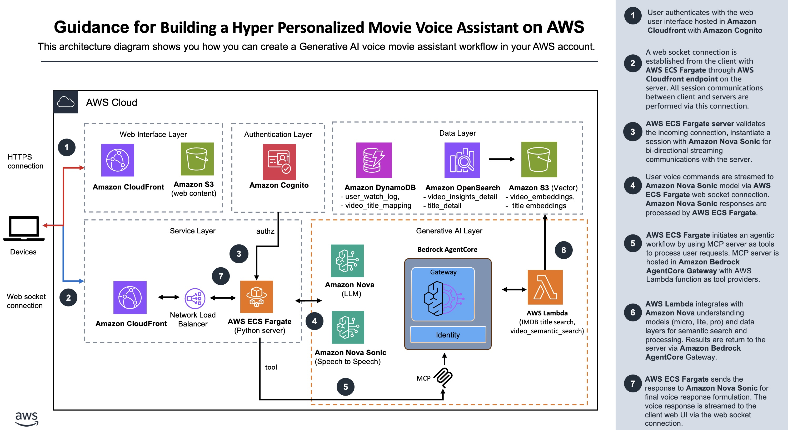

# Speech to Speech Movie Recommendation Solution

## Overview

A real-time speech-to-speech communication platform powered by Amazon Bedrock's Nova model for advanced language processing and AWS real-time messaging capabilities, featuring a WebSocket server and React frontend. Nova enables natural, context-aware speech-to-speech conversations through its state-of-the-art language understanding and generation capabilities.

## Architecture



The solution consists of three main components:

1. **Frontend Application**
   - React + TypeScript application
   - Real-time WebSocket communication
   - AWS Amplify for authentication
   
   
2. **Backend Infrastructure**
   - AWS CDK for infrastructure as code
   - Python WebSocket server running on AWS Fargate
   - Strands Agent for Agentic AI Integration
   - AgentCore Gateway for MCP server integration
   - Amazon Cognito for user authentication
   - CloudFront for content delivery
   - S3 for static website hosting
   - Network Load Balancer for WebSocket traffic
 
## Project Structure

```
.
├── react-client/      # React + TypeScript frontend application
├── backend/           # AWS CDK infrastructure and Java WebSocket server
│   ├── agentcore/     # AgentCore setup
│   ├── python_server/ # Python WebSocket server implementation
│   ├── stack/         # CDK infrastructure code
└── docs/              # Architecture diagrams and documentation images
```

### Backend Implementation Options

The solution supports two backend implementations with identical functionality:

#### Python WebSocket Server
- Python-based alternative implementation
- AWS Bedrock integration with `aws_sdk_bedrock_runtime` beta SDK
- Equivalent functionality to Java implementation
- **Python AWS SDK Notice**: This implementation uses the experimental AWS SDK for Python async clients. The SDK is in early development and may see rapid iteration with potential breaking changes between minor versions. For more details about the experimental AWS SDK, see: https://github.com/awslabs/aws-sdk-python/tree/develop

### Language Selection

The CDK deployment supports backend language selection:
- **Python**: `cdk deploy --context custom:backendLanguage=python`

The `cdk.json` file contains the context parameter `custom:backendLanguage` (set to "python" by default for Python deployment).

## Prerequisites

- [Python](https://www.python.org/downloads/) 3.12 or higher
- [Docker Desktop](https://docs.docker.com/desktop/install/)
- [Git](https://git-scm.com/downloads)
- [AWS CDK Toolkit](https://docs.aws.amazon.com/cdk/v2/guide/cli.html)
- [AWS CLI](https://docs.aws.amazon.com/cli/latest/userguide/install-cliv2.html)
```
aws configure --profile [your-profile] 
AWS Access Key ID [None]: xxxxxx
AWS Secret Access Key [None]:yyyyyyyyyy
Default region name [None]: us-east-1 
Default output format [None]: json
```
- Node.js: v18.12.1 or higher
- npm 8.x or higher
- Ensure you enable model access to Amazon Nova Sonic in the [Bedrock console](https://us-east-1.console.aws.amazon.com/bedrock/home?region=us-east-1#/modelaccess) in the region you intend to deploy this sample. For an up to date list of supported regions for Amazon Nova Sonic, please refer to the [documentation](https://docs.aws.amazon.com/bedrock/latest/userguide/models-regions.html)
- Chrome, Safari, or Edge browser environment (Firefox is currently not supported)
- Microphone and speakers

## Deployment

1. If not done already, clone this repository:

   ```shell
   $ git clone https://github.com/wei-m-teh/speech-to-speech-movie-recommender.git
   ```

2. Create a subfolder for react-ui, and enter the backend directory:

   ```shell
   $ mkdir -p react-client/dist && cd backend
   ```

3. Create a virtualenv on MacOS and Linux:

   ```shell
   $ python3 -m venv .venv
   ```

   After the init process completes and the virtualenv is created, you can use the following
   step to activate your virtualenv.

   ```shell
   $ source .venv/bin/activate
   ```

4. Once the virtualenv is activated, you can install the required dependencies.

   ```shell
   $ pip install -r requirements.txt
   ```

5. Run the following to bootstrap your account:

   ```shell
   $ cdk bootstrap
   ```

6. Run AWS CDK Toolkit to deploy the Backend stack with the runtime resources.

   ```shell
   $ cdk deploy --require-approval=never --all
   ```

   Any modifications made to the code can be applied to the deployed stack by running the same command again.


Get the CloudFront domain name:

```shell
aws cloudformation describe-stacks \
  --stack-name NovaSonicSolutionBackendStack \
  --query 'Stacks[0].Outputs[?OutputKey==`CloudFrontDistributionDomainName`].OutputValue' \
  --output text
```

7. Enabling AgentCore (Optional)

By default, Nova Sonic model uses tools to perform specialized tasks, such as get movie recommendation by invoking a lambda function. For production deployment, you could optimize the solution by configuring the lambda function as a AgentCore Gateway target to decouple the lambda function from the Agent. This approach enables the application to leverage MCP to access data and perform tasks. Follow the following steps to enable AgentCore Gateway for this application:


    7a. Capture the lambda function ARN that powers the movie recommendation. Run the following CLI command:

   ```shell 
   aws cloudformation describe-stacks  --stack-name NovaSonicSolutionBackendStack \
   --query 'Stacks[0].Outputs[?OutputKey==`ConvoSearchLambdaFunctionArn`].OutputValue' \
   --output text
   ```

   7b. Run the following python script to create an AgentCore Gateway with the lambda function as the Gateway target:

   ```shell
   cd backend/agentcore
   python create_agentcore_gateway.py--lambda-arn <the lambda function ARN from the command above>
   ```

   7c. Capture output from `create_agentcore_gateway.py` contains the information we need to configure the backend to use the newly created AgentCore Gateway. For instance, a sample output snippet from the script execution:

   ```shell
   ✓ Cognito Resource Server ID: movie-assistant-agentcore-gateway-id
   ✓ AgentCore Gateway URL: https://movie-assistant-gateway-xxxxx-xxxxxxx.gateway.bedrock-agentcore.us-east-1.amazonaws.com/mcp
   ✓ AgentCore Gateway Target Name: movie-assistant-target-12345
   ✓ AgentCore Gateway Target Tool Name: movie-assistant-target-12345__get_title_recommendation
   ``` 

   7d. Open [backend/stack/stack_constructs/fargate_nlb_constructs.py](backend/stack/stack_constructs/fargate_nlb_constructs.py) and update the environment variables for the ECS task definition:
   
   ```python

   "AGENTCORE_GATEWAY_URL": "https://movie-assistant-gateway-xxxxx-xxxxxxx.gateway.bedrock-agentcore.us-east-1.amazonaws.com/mcp",
   "AGENTCORE_COGNITO_RESOURCE_SERVER_ID" : "movie-assistant-agentcore-gateway-id",
   "AGENTCORE_GATEWAY_TOOL_TITLE_RECOMMENDATION" : "movie-assistant-target-12345__get_title_recommendation",
   "USE_AGENTCORE_GATEWAY" : "True"
   ```

   7e. Deploy the backend to pick up AgentCore Gateway changes:

   ```shell 
   cdk deploy --require-approval=never --all
   ```

8. Deploy the frontend:

   ```shell
   $ cd react-client
   $ npm install
   $ npm run deploy
   ```

   Note: The build output in `react-ui/dist/` directory will be automatically deployed by the backend CDK stack to S3 and served through CloudFront.

   The frontend can be accessed at the domain name from the CDK stack (XXXX.cloudfront.net) or Cloudformation output.


## User creation

First, locate the Cognito User Pool ID, through the AWS CLI:

```shell
$ aws cloudformation describe-stacks --stack-name NovaSonicSolutionBackendStack --query "Stacks[0].Outputs[?contains(OutputKey, 'UserPoolId')].OutputValue"

[
    "OutputValue": "<region>_a1aaaA1Aa"
]
```

1. Navigate to AWS Console:
2. Search for "Cognito" in the AWS Console search bar, Click on "Cognito" under Services, Click on "User Pools" in the left navigation.
   Find and click on the User Pool created by the CDK stack you recovered above.
3. In the User Pool dashboard, click "Users" in the left navigation. Click the "Create user" button and create user with password.

## Usage

1. Open your browser and go to the application URL (CloudFront domain from CDK outputs) previously recovered.
2. Login with the user and password that you setup in the Cognito user pool.
3. Click the "Start Streaming" button. When prompted, allow access to your microphone.
4. Begin speaking - you should see your speech being transcribed in real-time on the UI
5. The assistant will automatically process your message and respond through speech
6. Click "Stop Streaming" when you're done
   
> Note: Ensure your microphone is properly connected and working before testing. The browser may require you to grant microphone permissions the first time you use the feature.


## Load Movie Data
At this point, you have deployed a working solution with a front end and backend components. Next, we'll populate the movie datasets so that the application could access these data and provide users with movie insights and recommendation.

### Ingest Title Catalog 
Open [title-catalog-ingestion.ipynb](backend/tools/title-catalog-ingestion.ipynb) and run the noteook end to end to ingest the synthetically generated movie catalog dataset into an Opensearch serverless index. After running the notebook, the movie agent is now able to answer questions about movie recommendation. For instance, "I am in the mood for action movie, what do you recommend?"

### Ingest Video Insights
Due to license restrictions, we will enable , a movie with [Creative Common Attribution 3.0](https://mango.blender.org/about/) license for search, watch, and perform scene level analysis. Follow the steps below to enable this movie:

1. Open [bda-video-ipynb](backend/tools/bda-video.ipynb), follow the instructions given and run the notebook end to end. It will extract the key insights of the movie using Bedrock Data Automation, and persist them into an OpenSearch serverless collection. 

2. Open [script_analysis.ipynb](backend/tools/script_analysis.ipynb), follow the instructions given and run the notebook end to end. It'll extract the script for the movie, use it as the knowledge base to help answer about the movie. The notebook uses Bedrock Data Automation to extract the text from the movie script, perform preprocessing to clean up the content, then create vector embeddings and ingest into OpenSearch serverless collection as vector database. We use Bedrock Knowledge Bases to manage the ingestion, embedding creation and semantic search.


## Clean Up

Do not forget to delete the stack to avoid unexpected charges.

```shell
cdk destroy --all
```

Delete the associated logs created by the different services in Amazon CloudWatch logs.

Ensure S3 buckets are emptied before deletion.

## Security

See [CONTRIBUTING](CONTRIBUTING.md#security-issue-notifications) for more information.

## License

This library is licensed under the MIT-0 License. See the LICENSE file.

## Contrbutors
Thanks to Arturo Velasco, Daryl Cartwright, George Vasels, Juan Andres Caycedo, Vince Palazzo, Wei teh and Tulip Gupta for their contributions. 
