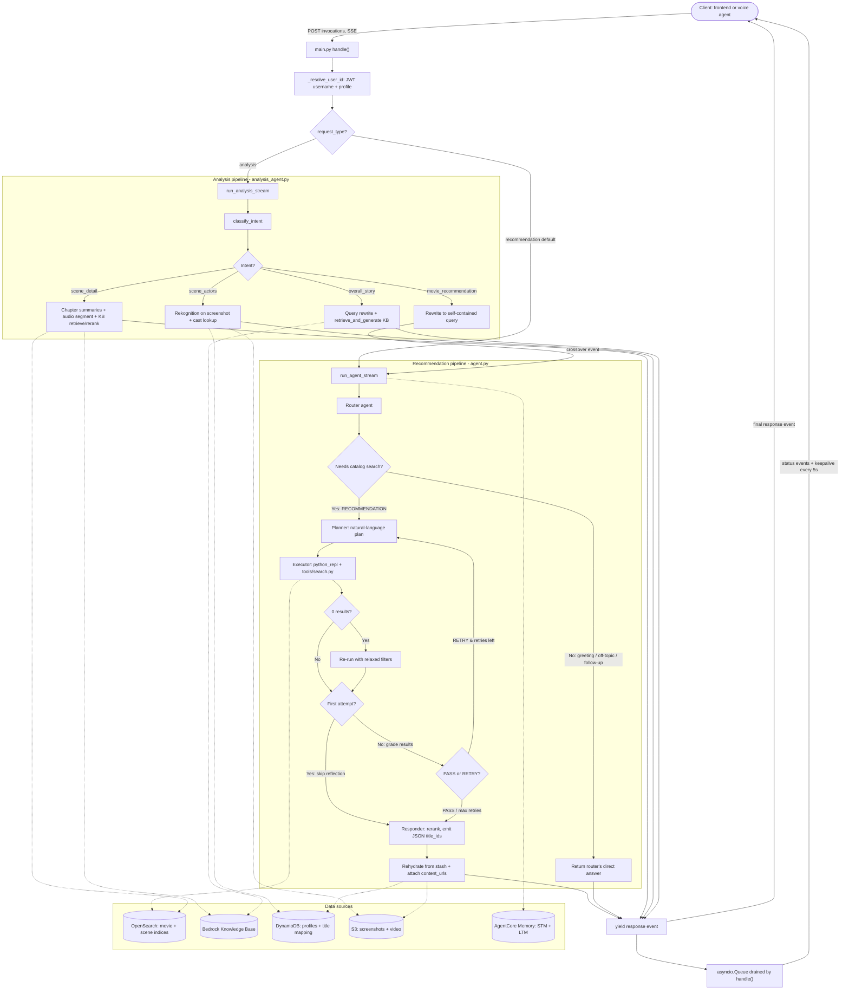

# Movie AI Agent — Workflow

The movie AI agent is a single AgentCore runtime (`main.py`) serving two
pipelines behind one streaming endpoint. It dispatches on `request_type`,
resolves the caller identity from the JWT, runs the chosen pipeline on a
background thread, and drains its yielded events out over SSE (with a 5s
keepalive during silent gaps).

## Recommendation pipeline

A five-stage loop where each stage is its own Strands `Agent` with its own
model, so cost tracks difficulty.

- **Router** decides whether the message needs a catalog search. Greetings,
  off-topic asks, and follow-ups about already-recommended titles are answered
  directly and skip the rest of the pipeline.
- **Planner** produces a natural-language search plan (does not write code).
- **Executor** turns the plan into a single Python script run through
  `python_repl`, calling the helpers in `tools/search.py` against OpenSearch. If
  the search returns nothing, it runs once more with relaxed filters.
- **Reflector** grades results and can loop back to planning. Skipped on the
  first pass for latency, so it only runs on a retry.
- **Responder** reranks against user preferences and emits JSON with the final
  `title_ids`, which are rehydrated from the module-level stash into full
  records plus presigned `content_urls`.

## Analysis pipeline

An intent classifier routes each scene question to one of four paths:

- **Scene detail** — chapter summaries, audio-segment dialog, and Knowledge
  Base retrieval + rerank.
- **Scene actors** — Rekognition celebrity detection on the scene screenshot
  combined with a catalog cast lookup.
- **Overall story** — history-aware query rewrite, then `retrieve_and_generate`
  against the Knowledge Base.
- **Recommendation** — rewrites the question into a self-contained query and
  hands off to the recommendation pipeline mid-stream (crossover), so "find me
  more like this" works while watching.

## Workflow diagram

## Notes

- Every stage transition also yields `status` events; the diagram shows only the
  final `response`/status flow back to the client for readability.
- Memory (STM history + one LTM retrieval on the first turn of a session) feeds
  the router and planner inputs. Each completed turn is written back, with
  previously recommended `title_id`s tracked for exclusion.
- The stash is a module-level dict keyed by `title_id`: the executor fills it,
  the models only see a trimmed projection, and full records are pulled back out
  at the `Hydrate` step, keeping images and full plots out of the token budget.
