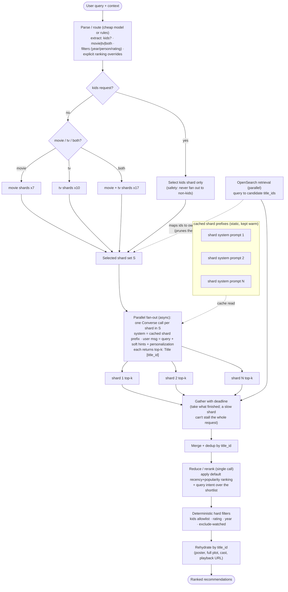

# Parallel Fan-Out Recommendation — Design

An approach for serving recommendations by ranking a large catalog **in-context**
with an LLM, kept fast by sharding the catalog into cached prefixes and fanning
out across them in parallel, and kept accurate by a retrieval catch-all plus a
final rerank. The goal is **low latency without sacrificing recall**.

## Why this shape

- A single full-catalog prompt does not fit (all titles at a rich projection is
  ~1.3M tokens). Sharding into token-balanced pieces keeps each prompt in the
  model's high-recall zone.
- Prompt caching makes each static shard cheap on repeat calls, so the per-shard
  cost is dominated by a discounted cache read plus a small output.
- Parallelism means wall-clock ≈ the *slowest* shard, not the sum — so latency
  stays roughly flat as the catalog grows (cost grows, latency does not).

## Shard topology (built offline)

Produced by `build_kids_split.py` then `build_shards.py`:

| Category | Shards | Titles | Notes |
|----------|-------:|-------:|-------|
| kids     | 1      | 218    | Safety partition; requests never leave it. |
| movie    | 7      | 1,502  | `movie` + `tvMovie`, token-balanced (~28k each). |
| tv       | 10     | 2,052  | `tvSeries`/`tvEpisode`/`tvMiniSeries`/`tvSpecial`. |
| other    | —      | 94     | `videoGame`/`video`/`short`, unsharded for now. |

Each shard is a **static, cached system prompt** (instructions + medium-projection
catalog: title, year, type, genres, imdb rating, one-line plot, top-6 cast names,
director/writer names). The prompt includes a default recency+popularity ranking
rule (deferring to the user when they specify otherwise) and requires output as
`<Title> [<title_id>]` so results are referenceable.

## Runtime flow



## Implementation decisions

**Concurrency.** `boto3`'s `converse` is synchronous, so the fan-out uses
`asyncio` + `asyncio.to_thread` (or a `ThreadPoolExecutor`) — one task per selected
shard, all issued at once. Wall-clock is set by the slowest shard, not the sum.

**Two-stage shard selection.** Category routing first (kids → kids only;
movie/tv/both → that category's shards). When the request does not indicate
movie vs TV, **default to movie**; route to `both` only when the query mentions
both. Then, because token-balanced shards have
no semantic locality, either fan out to *all* shards in the category, or **prune**
using the OpenSearch retrieval that is already running as the catch-all: map its
top candidate `title_id`s to their owning shards and hit only those. Pruning turns
"17 calls" into "the 3-4 shards that actually contain relevant titles" — the main
cost lever.

**Deadline / hedging.** Because latency is the slowest shard, the gather step has a
hard deadline and proceeds with whatever returned; the reduce step still has ample
candidates. The parallel OpenSearch retrieval provides a fast floor of candidates
if a shard is slow.

**Merge → reduce → filter → rehydrate.** Union and dedup by `title_id` (why the id
is in the output format). One reduce call reranks the shortlist and applies the
default recency/popularity ranking. Deterministic hard filters then enforce the
guarantees the prompt cannot (kids allowlist, rating, year, exclude-watched).
Finally, rehydrate full records by `title_id` for the UI.

**Cache dependency.** Every selected shard prefix must be warm within the TTL for
the fan-out to hit per-shard latency (~1.5-2s measured) rather than a cold read.
Under bursty traffic the kids shard and popular movie/tv shards stay warm; cold
shards pay the write cost. The fan-out's latency guarantee is only as good as the
cache hit rate — this is the primary operational risk.

**Cost vs latency.** Parallelism keeps latency flat as shards are added, but cost
scales linearly with the number of shards fanned out to (each is a cache read plus
output). Hence prune the shard set rather than always hitting all shards.

## End-to-end latency model

```
total ≈ route + max(selected shard latencies, retrieval) + reduce + rehydrate
```

The single-shard latency benchmark (`notebooks/shard_latency_benchmark.ipynb`)
measures the `max(shard)` term for the largest shard. The fan-out benchmark
measures the full `max(...) + reduce` path against firing the same shards
sequentially, to confirm the parallel speedup.

## A/B: fan-out vs catch-all (retrieve-then-rerank) — conclusion

We evaluated whether the **catch-all** path (OpenSearch retrieval → single LLM
rerank) could replace the fan-out entirely, motivated by its latency advantage.
Benchmarks in `notebooks/unified_pipeline_benchmark.ipynb`; quality scored by an
LLM-as-judge (Claude Haiku, temperature 0, list positions randomized, both lists
produced by the same reranker so there is no self-preference asymmetry) over six
pure mood/theme queries.

### Latency (measured, movie domain, warm cache)

| Path | Avg end-to-end | LLM calls |
|------|----------------|-----------|
| catch-all | ~1.4 s | 2 (decompose + rerank) |
| fan-out (7 movie shards) | ~3.3 s | 9 (decompose + 7 shards + rerank) |

Catch-all is ~2.5x faster and ~4x cheaper in model calls. On **cache**: only the
fan-out shards clear the model's cache-size minimum (~196k tokens read per fan-out
query, all warm hits); the catch-all's small router/rerank prompts never cache.

### Quality (LLM-as-judge, mood queries) — catch-all could NOT match fan-out

We tried four catch-all retrieval configurations, holding the reranker constant:

| Catch-all retrieval | catch-all avg score | fan-out avg | wins |
|---------------------|:-------------------:|:-----------:|------|
| Dense KNN, `GENERIC_INDEX`, k=15 | 3.83 | 5.00 | fan-out 6–0 |
| Dense KNN, `TEXT_RETRIEVAL`, k=15 | 3.83 | 4.83 | fan-out 5–1 |
| Hybrid BM25+KNN, k=15 | 3.83 | 5.00 | fan-out 6–0 |
| Hybrid BM25+KNN, k=35 (matches fan-out feed) | 3.83 | 5.00 | fan-out 6–0 |

Catch-all's average sat at **exactly 3.83 in every configuration.** Changing the
query embedding purpose, adding lexical/hybrid retrieval, and raising k to match
the fan-out's candidate count all failed to move it.

### Why (structural, not a tuning gap)

Both paths use the **same** reduce/rerank step, so the difference is entirely the
**candidate pool**:

- **Catch-all** selects candidates by *similarity* (vector + lexical). Iconic,
  clearly-apt titles that a person would expect often do not rank in the top-k by
  similarity, so they never enter the pool — and no rescoring, fusion, or larger k
  recovers a title that similarity ranks too low.
- **Fan-out** has an LLM *read the full records* (plot, cast, genres) of every
  title in each shard and select the best. It surfaces the apt/iconic titles that
  similarity under-ranks.

LLM-selection-over-full-records produces a materially better pool for mood/theme
queries than similarity retrieval, independent of retrieval tuning.

### Decision

- **Do NOT go catch-all-only.** On pure mood/theme queries it takes a consistent,
  well-tested quality hit (3.83 vs ~5.0; lost 23 of 24 head-to-heads).
- **Keep the routed hybrid** (the design above): catch-all for filter-bearing
  queries (person, era, rating, exact title — fast, exact, and as-good-or-better
  there); fan-out for pure mood/theme queries (where reading full records wins).
- **Keep hybrid + `TEXT_RETRIEVAL` on the catch-all path** anyway: they are free
  recall/correctness for the filter queries catch-all serves, even though they do
  not turn catch-all into a fan-out replacement.

### Caveats

- Single Haiku judge; a fame bias (recognizing iconic titles) is plausible but is
  arguably aligned with user expectations for comfort/mood picks. Corroborate with
  a stronger judge or human ratings before a final production call.
- Six mood queries is a small set; the direction is strong and consistent (four
  configs, 22–24 of 24 head-to-heads to fan-out) but not a large-sample eval.
- All catch-all retrieval experiments were isolated in the notebook; the shared
  `tools/opensearch_client.py` (`generate_embedding`, `GENERIC_INDEX`) and the
  production query path were left unchanged.
