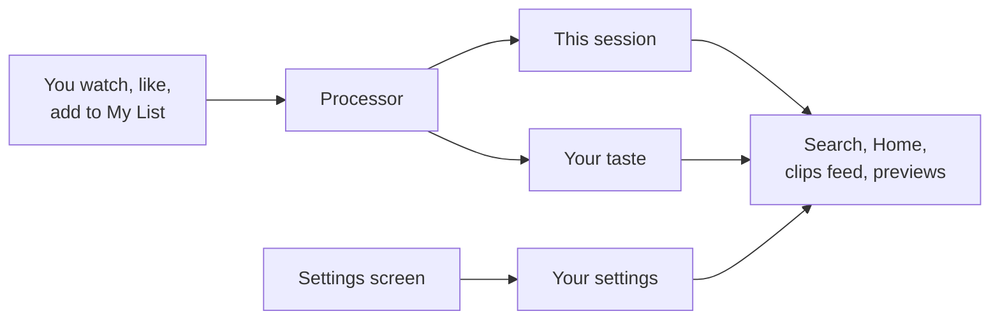
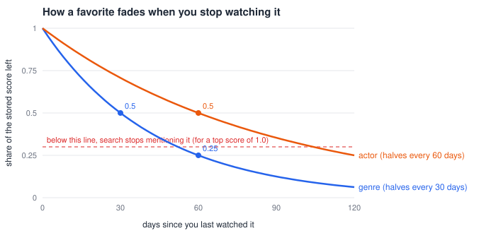
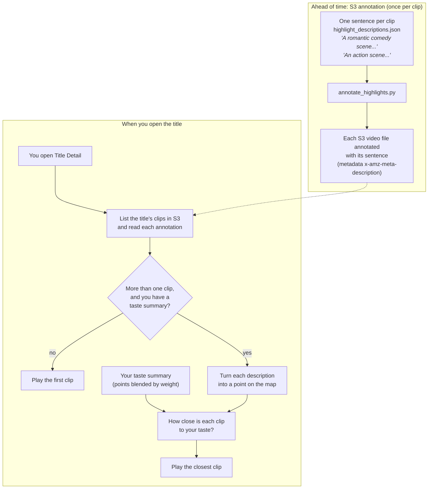

# How personalization works

The app learns from what each profile watches and uses it to tailor search,
Home, the clips feed and previews. This page explains how, in plain terms. For
the full design, see [unified-profile-design.md](unified-profile-design.md).

## 1. What the app remembers

Every view, like and My List add is sent as an event. A background processor
turns those events into three kinds of memory:

| Memory | What it is | How long it lasts | Name in the code |
|---|---|---|---|
| **This session** | what you watched in the last few hours | until you reload or switch profile, or 4 hours after your last activity | L1, `SESSION#behavior` |
| **Your taste** | your favorite genres and actors, plus a summary of the kinds of titles you like | months; favorites fade if you stop watching them | L2, `AFFINITIES` |
| **Your settings** | what you told the app: genres to avoid, kids limits, teams you follow | until you change them | L3, `L3#DECLARED` |

Settings always win. If you exclude Horror, no screen shows Horror, whatever
your viewing says.



**What counts.** Finishing a film counts strongly. Adding to My List, a like
and "more like this" count strongly too. Stopping a film early counts against
it. Watching under 2 minutes, or swiping a clip away quickly, counts for
nothing: that's browsing, not an opinion. Opening a search result is only
interest: it barely moves your favorites and never your taste summary. If you
then watch the title, the viewing counts.

| What you did | Strength (`e`) |
|---|---|
| opened a search result | 0.05, favorites only |
| watched a show 10-50% | 0.1 |
| watched a clip 2-10 s | up to 0.3 |
| watched half a clip | 0.4 |
| liked | 0.5 |
| watched a show 50-90% | 0.5 |
| finished a clip | 0.6 |
| added to My List, "more like this" | 0.7 |
| finished a show, replayed a clip | 0.8 |
| "Mark as watched" on Title Detail | 0.8, the same as finishing it |
| stopped a show under 10% | −0.4 |
| "less like this" | −0.4 |

**One title, one contribution.** Watching a title and then liking it counts
as one title, not two. Its signals combine: the strongest one, plus 0.2 when
two or more are positive, up to 1.0 (finished and liked = 1.0). Only the
change since the title last counted is applied, so the like adds 0.2 on top
of the finished view, and the evidence counts go up once. A dislike replaces
the positives. After 30 days a title counts afresh, so a rewatch months later
refreshes your taste. "Mark as watched" counts as a view of the title, so
watching part of it and then marking it is still one title, scored as
finished; a marked title is also left out of recommendations, like one you
finished. A poster card in the clips feed counts as a clip of
its title, separately from watching the title itself.

## 2. Your taste summary

Every catalog title has a position on a "map" of meaning, where similar titles
sit close together. Your taste summary is up to
**3 points on that map**, one for each kind of title you like, for example
"cerebral sci-fi" and "rom-coms". The code calls these points *centroids*.

- **The first liked title is the first point.**
- **Each point keeps its evidence:** the strengths of everything that formed
  it added up. A finished film adds 0.8, a 5-second clip about 0.1.
- **A liked title close to a point** moves it in proportion to the title's
  strength: by `e / (evidence + e)`. While a point is young this is a
  strength-weighted average, so the second finished film counts as much as
  the first, and a weak signal barely moves a strong one. Once a point has
  plenty of evidence, each title moves it by a fixed 10% of its strength, so
  taste keeps adapting slowly.
- **A liked title unlike anything so far** starts a new point, up to 3. After
  that it only nudges the nearest point a little.
- **Each point's weight comes from its evidence:** `evidence / (evidence + 2)`.
  One finished film gives 0.29, three give 0.55, ten give 0.8. One weak
  signal can't make a point look certain.
- **Dislikes don't move it**, and **it never fades**. Avoiding things is the
  job of favorites and settings.
- **A brand-new profile has none** until it likes its first title.

Search and the clips feed use these points to find titles that "feel like"
what you enjoy, even when they share no genre label.

## 3. Your favorite genres and actors

For every genre and lead actor (the first 3 cast) on titles you watch, the app
keeps two things: a **score** for how much you like it, and a **count** of
how many times it has seen evidence.

- **Each scored view** raises (or lowers) the score of that title's genres and
  lead actors. A clip counts half as much as the full title.
- **It needs 3 pieces of evidence** before anything uses it. Picking a genre
  at sign-up counts as 3, so it works from day one.
- **Scores fade** when you stop watching: a genre's score halves every 30
  days, an actor's every 60.



**Example.** A new profile picks Sci-Fi at sign-up.

| Day | What happens | Score | Search mentions Sci-Fi? |
|---|---|---|---|
| 0 | picks Sci-Fi at sign-up | 0.50 | yes, "Enjoys Sci-Fi" |
| 10 | finishes a sci-fi film | 0.52 | yes |
| 70 | no sci-fi since day 10 | faded to 0.13 | no, too weak |

The evidence count never fades; only the score does.

### How the taste summary and favorites differ

Both learn from the same viewing, but they answer different questions.

- **The taste summary finds titles that feel similar.** It has no labels, so
  it can tell a quiet, cerebral sci-fi film from a loud action one.
- **Favorites put taste into words.** "Enjoys Sci-Fi" can be given to the AI
  model, shown on Home as a row, or used as a filter. They can also record
  dislikes, which the taste summary can't.

**Example:** a viewer keeps finishing films like *Eternal Space* and *Infinite Stars*.
The taste summary helps search find *Tomorrow Cosmos* and *Tomorrow Universe*, which feel
similar. The favorites tell the agent "Enjoys Sci-Fi" in words, so it can
rank and explain the results, and Home can show a "Because You Like Sci-Fi"
row.

### Time of day

The app also keeps a smaller copy of your favorites for four time slots:
weekday or weekend, daytime (05:00-17:00) or evening. Only views you actually
watched count (not "Mark as watched", which has no time of viewing), in
your local time. Once a slot has **3 scored views**, a search made in that
slot gets one extra hint, such as "Weekday evenings: mostly Sci-Fi;
full-length titles". You never have to mention the time. The hint only nudges
the order of results; your request always wins.

### What it looks like in storage

Your taste summary, your favorites and the time-of-day copies are all stored
on one item per profile: `AFFINITIES` in the `profiles` table. Here is that
item after one week of viewing, in US Central time:

- **Mon, Tue, Wed 21:00:** finishes three dramas; Monday's and Wednesday's are
  also sci-fi.
- **Thu 12:00:** adds a drama to My List.
- **Sat 20:00:** finishes another drama.

```json
{
  "user_id": "p-1234",
  "data_type": "AFFINITIES",
  "tz_offset_min": -300,
  "centroids": [
    {"v": "x3J6u7VN...", "w": 0.661, "n": 5, "e": 3.9}
  ],
  "entities": {
    "genre:drama":  {"s": 0.5482, "n": 5, "label": "Drama",  "last": 1792890000},
    "genre:sci-fi": {"s": 0.2346, "n": 2, "label": "Sci-Fi", "last": 1792634400}
  },
  "contexts": {
    "weekday|evening": {
      "views": 3,
      "long_min": 330.0,
      "short_min": 0.0,
      "entities": {
        "genre:drama":  {"s": 0.3519, "n": 3, "label": "Drama",  "last": 1792634400},
        "genre:sci-fi": {"s": 0.2346, "n": 2, "label": "Sci-Fi", "last": 1792634400}
      }
    },
    "weekend|evening": {
      "views": 1,
      "long_min": 110.0,
      "short_min": 0.0,
      "entities": {
        "genre:drama":  {"s": 0.12, "n": 1, "label": "Drama", "last": 1792890000}
      }
    }
  }
}
```

The example shows only genres; the real item also has an entry per lead
actor, and a few more fields.

| Field | Meaning |
|---|---|
| `tz_offset_min` | your time zone, used to work out the current time slot |
| `centroids` | your taste summary: up to 3 points (`v`), each with its evidence (`e`, 4 views at 0.8 plus a My List add at 0.7), its weight `e / (e + 2)` (`w`) and the number of titles behind it (`n`) |
| `entities` | your favorites, from **everything**: views at any time, My List adds, likes, and a small step for search results you opened |
| `contexts` | one box per time slot, created by its first view. Each box holds only **views** that ended in that slot |
| `views` | how many views the box holds, whatever was watched |
| `long_min` / `short_min` | minutes of full titles and of clips in the box |
| `s` | the score: how much you like this genre or actor, from −1 to +1 |
| `n` | the evidence: how many events included this genre or actor |
| `last` | when it was last updated, used to fade `s` |

**Why the numbers differ.** The top-level `entities` and each box are
separate running scores, worked out the same way but fed different events:

- **Drama** is `n: 5` at the top level (4 views plus the My List add), `n: 3`
  in the weekday box and `n: 1` in the weekend box.
- **`views` and `n` are not the same thing.** The weekday box has 3 views,
  but Sci-Fi has `n: 2` there, because only 2 of those films were sci-fi.
- **Only the weekday box can produce a hint.** It has 3 views, and Drama
  there has `n: 3` and `s` ≥ 0.3, so a weekday-evening search gets "Weekday
  evenings (now): mostly Drama; full-length titles". The weekend box has only
  1 view, so a weekend search gets no time-of-day hint.

## 4. This session

While you watch, the app records plain facts about this session: what you
played, how much of it, short clips against full titles, and which genres held
your attention. It stores no guesses like "in a quick-clips mood"; the search
agent reads the facts and decides what they mean.

A new session (reload, or switching profile) starts empty. What should last
is already in your taste.

The clips feed keeps its own, separate session record of which cards you
watched and liked, so "more like this" changes the very next batch.

## 5. What each screen uses

| Screen | Uses |
|---|---|
| Search (the movie agent) | taste summary, favorites, this session, settings |
| Home rows | favorite genres, settings |
| Search suggestions | taste summary, settings |
| Clips feed | its own session record, taste summary, settings |
| Highlight preview | taste summary |

### 5.1 Search (the movie agent)

1. **Find candidates** that match your request. For some kinds of request,
   titles near your taste summary also get a boost.
2. **Leave out** titles you already played this session.
3. **An AI model picks and orders the results.** It sees your request, plus
   short hints: your favorites ("Strongly enjoys Sci-Fi"), the time-of-day
   hint and this session's viewing. The hints are soft; your request always
   wins.

### 5.2 Home rows

A new profile gets one "Because You Like <genre>" row for each of its top 3
favorite genres, filled with the best-rated titles in that genre, plus Top
Rated Movies and Top Rated Series. Your favorites choose **which genres** get
rows and in what order, not the titles inside them, so two Sci-Fi fans see the
same Sci-Fi row.

### 5.3 Search suggestions

The tappable suggestions on the empty Search screen ("a mind-bending sci-fi
puzzle") come from a fixed list of about 95. The app shows the ones closest
to your taste summary, at least one per kind of title you like. They change
only when your taste does. The suggestions shown after a result are different:
the AI model writes them for that search.

### 5.4 Clips feed

The feed shows cards in batches of 6. Each time you need more, the app sends
how you reacted to the cards you saw, and gets the next 6 back.

1. **Record your reactions** straight away, so "more like this" changes the
   very next batch. A swipe within 2 seconds counts for nothing; watching
   longer, liking or "more like this" counts for the card; a dislike counts
   against it. Reactions count less as minutes pass, so the feed follows your
   current mood.
2. **Work out what you're into right now:** similar cards you liked are
   grouped into a few interests. Your long-term taste summary is added: it
   drives the batch until you've reacted to something, then it only has a
   small say.
3. **Find candidates** close to those interests, plus a few award-winning titles for discovery. Your settings rule titles out here.
4. **Pick 6:** titles close to what you like rank higher, titles close to
   what you disliked rank lower, and very similar titles are spread out. The
   stronger your interests, the more cards follow them, but at least one card
   is always discovery.
5. **Explain:** each personalized card names the card that led to it:
   "Because you watched X".

### 5.5 Highlight preview

When a title has several highlight clips, each clip is annotated in S3 with a
one-sentence description ("A romantic comedy scene: a flirtatious
meet-cute..."). The sentences are written in
`infra/deployment/seed/highlight_descriptions.json`, and
`infra/deployment/annotate_highlights.py` attaches each one to its video file
as S3 object metadata (`x-amz-meta-description`), so the label travels with the
clip and no database is needed. The preview plays the clip whose description is
closest to your taste summary. Without a taste summary, it plays the first clip.



**Example.** *Tears of Steel* has two highlight cuts, one labelled as a
romantic scene (two former lovers reunite) and one as an action scene (a
battle with a giant robot in a cathedral). A rom-com fan's taste summary sits
much closer to the romantic clip's description than to the action clip's, so
the preview opens on the reunion. An action fan opening the same title gets
the battle. The cuts are made by `notebooks/tears-of-steel/1-video-scenes.ipynb`;
add cuts for your own titles under `clips/highlights/vod/` and describe them in
`infra/deployment/seed/highlight_descriptions.json`.

## 6. Key numbers

Checked against the code by `infra/deployment/test_personalization_doc.py`.

| Constant | Value | Meaning | Where |
|---|---|---|---|
| `HALF_LIFE_DAYS` | `{"genre": 30, "person": 60}` | days for a favorite's score to halve | `infra/lambdas/profile_events/l2.py` |
| `LOVED_N` | `3` | evidence needed before a favorite is used | `infra/lambdas/profile_events/l2.py` |
| `PARENT_FACTOR` | `0.5` | a clip counts half for favorites | `infra/lambdas/profile_events/l2.py` |
| `TASTE_MAX_CENTROIDS` | `3` | most points in a taste summary | `infra/lambdas/profile_events/l2.py` |
| `TASTE_EVIDENCE_K` | `2.0` | evidence at which a taste point's weight reaches 0.5 | `infra/lambdas/profile_events/l2.py` |
| `CENTROID_RATE` | `0.1` | how far a title moves an established taste point, per unit of strength | `infra/lambdas/profile_events/l2.py` |
| `ACCEPT_E` | `0.05` | strength of opening a search result (favorites only) | `infra/lambdas/profile_events/l2.py` |
| `BOTH_BONUS` | `0.2` | bonus when two signals on one title agree | `infra/lambdas/profile_events/l2.py` |
| `CAST_PER_TITLE` | `3` | lead actors tracked per title | `infra/lambdas/profile_events/l1.py` |
| `SESSION_TTL_S` | `14400` | session memory expires after this many seconds | `infra/lambdas/profile_events/l1.py` |
| `BUCKET_MIN_VIEWS` | `3` | views in a time slot before its hint appears | `backend/movie-ai-agent-v2/user_profile.py` |
| `MAX_GENRE_RAILS` | `3` | most "Because You Like" Home rows | `infra/lambdas/household/cold_start.py` |
| `BATCH` | `6` | cards per clips-feed batch | `infra/lambdas/clips_feed/clips_policy.py` |
